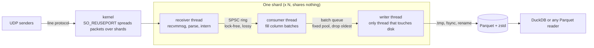

# FluxIngest

A telemetry ingestion engine in C++20. Metrics come in over UDP as InfluxDB line protocol. They go out as Parquet files you can query with DuckDB.

It's built around one rule: **when something can't keep up, drop data on purpose and count it. Never block, never grow memory.**

```
UDP ──> [receiver] ──SPSC ring──> [consumer] ──batch queue──> [writer] ──> shard0-20261016T120000Z-000001.parquet
        parse + intern  (lock-free,   fill column     (fixed pool,      Parquet + zstd,
        per sample      lossy)        batches         drop oldest)      .tmp → fsync → rename
```

- **Lock-free SPSC ring** with two overflow policies: drop-newest (wait-free) and drop-oldest (CAS steal).
- **Zero heap allocations per sample.** A test replaces `operator new` and checks this.
- **String interning** for metric names and tags. The ring only moves 24-byte structs.
- **Columnar batches → Parquet**, zero-copy into Arrow, one small dictionary per row group.
- **Fixed memory.** Everything is allocated at startup. The overload test shows RSS stays flat.
- **Every sample is accounted for.** It is either written or counted in exactly one drop bucket. The end-to-end test checks that the totals match exactly.

## Results

All numbers measured on an Intel i7-9750H laptop (6 cores, 2.6 GHz). Raw output is in [`bench/results/`](bench/results/). Laptops throttle under sustained load, so `scripts/bench_mac.sh` only keeps a run if the CPU was at full speed before and after it.

**Whole pipeline, one shard (3 threads), no network** (`bench_pipeline`):

| Sink | Series | Samples/s in | Drops | On disk |
|---|---|---|---|---|
| null (macOS) | 1,000 | 5.2M | 0 | — |
| null (macOS) | 100,000 | 4.7M | 0 | — |
| **Parquet + zstd** (Docker) | 10,000 | **4.2M written** | 0 | **1.96 bytes/sample** (raw is 24) |

With Parquet, the writer thread was busy 2.7 s out of 4 s, so the producer (parsing) is still the bottleneck.

**SPSC ring vs a mutex** (`bench_ring`, two threads, 10M samples):

| Queue | 1 per pop | 256 per pop |
|---|---|---|
| SPSC drop-newest | 34M/s | **284M/s** |
| SPSC drop-oldest | 10M/s | **286M/s** |
| mutex + fixed array | 7.8M/s | 11M/s |
| mutex + `std::deque` | 7.6M/s | 10M/s |

**What drop-oldest costs** (ns per push):

| Case | drop-newest | drop-oldest |
|---|---|---|
| Ring not full | 1.6 | 3.8 |
| Ring full, no consumer | 0.9 (reject) | 12.9 (CAS steal) |
| Ring full, consumer fighting over `head` | 2.9 | 12.7 |

Drop-oldest costs ~13 ns per sample under overload. That's still ~78M pushes/s, about 13x faster than the parser can produce samples. So the policy that keeps the newest data is affordable.

**Producer path** (`bench_parse`): parsing a 109-byte line with 3 tags, 3 fields and a timestamp takes 288 ns. Parse + intern + 3 pushes takes 500 ns, about **6M samples/s per core**. The interner takes 40 ns per lookup with 1K series and 94 ns with 1M series (cache misses).

**Real UDP** (Docker VM, 4 CPUs): one shard took 99.2% of 1.56M samples/s. The kernel dropped 0.8% of packets because Docker caps the socket buffer at 416 KiB (`net.core.rmem_max`). The load generator is single-threaded and was the limit, so these runs don't show shard scaling.

**Correctness:**
- 70 GoogleTest tests, clean under ASan + UBSan and TSan.
- 41 end-to-end checks.
- 10 minutes of libFuzzer: 3.7M inputs, no crashes.
- CI runs all of it on every push.

## Quick start

Arrow has no Homebrew bottle for Intel Macs, so the full build runs in Docker (Ubuntu 24.04 + Arrow's apt repo). The core (no Parquet) also builds natively.

```bash
# Full build + all tests (in Docker)
scripts/docker_build.sh            # or: asan, tsan

# End-to-end: real binary, real UDP, real Parquet, disk full, kill -9
scripts/e2e.sh

# Fuzz the parser for 10 minutes
scripts/fuzz.sh 600

# Core only, native (macOS or Linux, no Arrow needed)
cmake --preset dev && cmake --build --preset dev && ctest --preset dev
cmake --preset tsan && cmake --build --preset tsan && ctest --preset tsan
```

Run it:

```bash
fluxingest --port=8089 --out=./data --shards=2 --window=60
flux_loadgen --port=8089 --rate=500000 --duration=30 --series=10000
```

```
[fluxingest] info: memory budget: 239.2 MiB per shard x 2 shards = 478.4 MiB, allocated now, fixed after start
[fluxingest] info: overflow policy: drop-oldest, window 60s, batch 262144 rows x 4 buffers, ring 1048576 slots
[fluxingest] info: listening on udp://0.0.0.0:8089 (socket buffer 416 KiB), writing to ./data
[stats] in=292.5k/s offered=590.2k written=0 | dropped ring=0 batch=0 write_err=0 cardinality=0 | parse_err=0 kernel_drops=0 | ring=0% queued=0 files=0 (0.0 MiB) | series metrics=4 tagsets=10000 | arrow_pool=0.6 MiB
```

On Linux, raise `net.core.rmem_max` (e.g. to 16 MiB) so the 16 MiB socket buffer is actually granted. Bursts then land in the kernel buffer instead of being dropped.

Query the output:

```sql
-- duckdb
SELECT metric, tags, avg(value), count(*)
FROM read_parquet('data/*.parquet')
GROUP BY ALL ORDER BY 4 DESC LIMIT 10;
```

## Parquet schema

| Column | Type | Encoding |
|---|---|---|
| `ts` | timestamp[ns, UTC] | DELTA_BINARY_PACKED (timestamps rise, so the deltas are tiny) |
| `metric` | dictionary&lt;string&gt; | RLE_DICTIONARY, e.g. `cpu.usage_user` |
| `tags` | dictionary&lt;string&gt; | RLE_DICTIONARY, canonical `host=a,region=us` (sorted, escaped) |
| `value` | double | BYTE_STREAM_SPLIT (helps zstd compress floats) |

One file per shard per time window. One row group per batch. Everything is zstd-compressed.

## Architecture



- **Each thread owns one thing.** Receiver owns the socket and interner. Consumer owns the open batch. Writer owns the disk.
- **Every hand-off is bounded.** A full ring or full batch queue drops data and counts it. Nothing waits.
- **Shards share nothing.** Each has its own socket, ring, batches and files. More cores = more shards.
- **All memory is allocated at startup.** The log prints the budget per shard.

## How it works

### Producer: parse and intern (receiver thread)

- Linux reads up to 64 datagrams per syscall with `recvmmsg`. `SO_RXQ_OVFL` reports packets the kernel dropped before we saw them.
- The parser is zero-copy (`string_view` into the packet) and allocation-free. Delimiters are found with a 256-entry lookup table. Numbers use `fast_float`.
- Tags are sorted and joined into one canonical string, so `host=a,dc=1` and `dc=1,host=a` are the same series.
- The interner turns strings into 4-byte ids. Only this thread writes it, so it needs no locks. Strings live in a preallocated arena. There's a hard cap on distinct strings (cardinality limit).

### SPSC ring

- Power-of-two size. Indexes are 64-bit counters that never wrap, so "full" is just `tail - head == capacity`.
- Head and tail sit on separate 128-byte-aligned lines. 128, not 64, because Intel's prefetcher pulls cache lines in pairs.
- Each side caches the other side's index. It only reads the shared one when its cached copy says full or empty.
- The consumer pops in batches: one index update per batch, not per sample.

**Drop-oldest** is the hard one. It breaks the SPSC rule that only the consumer moves `head`:

1. When the ring is full, the producer CASes `head` forward to "steal" the oldest slot, then overwrites it.
2. The consumer copies slots first, then claims them with a CAS on `head`.
3. If the CAS fails, the producer stole some of them. A release/acquire fence pair (the seqlock pattern) proves the copies at or past the new `head` are still clean. So the consumer keeps those and retries the CAS. It never re-copies, because re-copying would livelock under overload.
4. Slot words are `std::atomic<uint64_t>` with relaxed ordering. That's a plain `mov` on x86, but it makes the racy read legal C++ that ThreadSanitizer can check.

A stress test sends 50M samples through two threads and checks every one for torn reads, ordering, and exact counts. When I replaced the CAS with a plain store as a deliberate bug, the test failed. That shows it can catch this kind of mistake.

### Consumer: column batches

- The consumer drains the ring into preallocated, 64-byte-aligned column arrays.
- A batch is sealed when it's full **or** its time window ends. Sealing only on time ("flush every 60 s") would let one window hold 60 s × the ingest rate in memory.
- Global ids are remapped to a small per-batch dictionary. The remap table tags each entry with a batch number ("epoch"), so it never needs clearing.
- When a pop comes back small, the consumer backs off (spin, then yield, then a 200 µs sleep) so samples pile up and get drained in big runs. In the ring micro-benchmark, a consumer trailing right behind the producer made cache lines bounce between cores and cut throughput ~2.8x. In the full pipeline it made no measurable difference (the producer is slower because it parses), so here it mostly stops the consumer from spinning.

### Writer: Parquet

- The writer is the only thread that touches the disk.
- Column arrays are wrapped as `arrow::Buffer` with no copy, then written as one row group.
- Commit: write the footer, `fsync` the file, `rename` `.tmp` → `.parquet`, then `fsync` the directory. Readers glob `*.parquet`, so they never see a partial file. On startup, leftover `.tmp` files are deleted.

## Failure modes

| What goes wrong | What happens | Counter | Tested by |
|---|---|---|---|
| Producer faster than consumer | Ring full. Oldest (or newest) sample dropped. Producer never waits. | `dropped_ring` | `test_ring_stress`, `test_pipeline` |
| Disk slow | Batch queue full. Oldest sealed batch evicted. Memory stays flat. | `dropped_batch` | `test_consumer_writer`, e2e overload |
| Disk full / I/O error | `.tmp` deleted, rows counted, exponential back-off, recovers when space returns. | `dropped_write_error` | `test_parquet_sink` (real 1 MiB tmpfs), e2e disk full |
| Disk hangs forever | Ingestion continues. On shutdown, gives up after a timeout and exits without waiting. | — | `test_pipeline` (stuck writer) |
| Too many distinct series | New series rejected, existing ones keep working. | `cardinality_rejected` | `test_ingestor`, e2e cardinality |
| Kernel socket buffer full | Kernel drops packets. Reported via `SO_RXQ_OVFL`. | `kernel_drops` | e2e overload |
| Garbage input | Line rejected with a reason code. Oversized datagrams dropped whole. | `parse_errors`, `truncated_datagrams` | `test_line_protocol`, libFuzzer |
| `kill -9` | Committed files are intact. The open file stays `.tmp` and is cleaned up on restart. | — | e2e crash |
| Network partition | Packets just stop arriving. UDP senders never block on us. | — | — |

## Design trade-offs

- **UDP, not TCP.** Telemetry is lossy by design (StatsD, InfluxDB UDP). A slow ingester must never block the services sending metrics. With TCP, a full receive window pushes back into the sender's `write()`.
- **Drop-oldest by default.** For metrics, recent data is worth more than old data. It costs more under overload (see Results). Use `--overflow=drop-newest` if that matters more.
- **A mutex between consumer and writer.** It's taken once per batch (every ~256K samples), not per sample, so it costs nothing measurable. It also gives a condition variable, so the writer sleeps instead of polling. The writer never holds it during I/O.
- **Data in memory is lost on a crash.** Up to one window of unsealed data. A write-ahead log would fix this, but would add a disk write per sample. For lossy telemetry that's the wrong trade.
- **One small dictionary per row group**, not one global dictionary. A global one would repeat every string ever seen in every row group, and Parquet falls back to plain encoding when a dictionary page passes 1 MiB.

## Layout

```
include/flux/   header-only hot path: spsc_ring, interner, arena, hash, line_protocol, ingestor, counters
src/            batch + exchange, consumer, writer, parquet_sink, udp_receiver, pipeline (shard), main
tools/          flux_loadgen
tests/          GoogleTest: unit, stress, no-alloc, pipeline, Parquet round trip, disk full
bench/          Google Benchmark micro-benchmarks + whole-pipeline benchmark, results/
fuzz/           libFuzzer target + seed corpus
scripts/        docker_build.sh, e2e.sh / e2e.py, fuzz.sh
```

## What's next

- `io_uring` for receive and write (Linux only; skipped because development is on macOS).
- Upload committed files to S3, with the same `.tmp` → rename idea using multipart upload.
- Several producers per shard (MPSC ring) for TCP or gRPC input.
